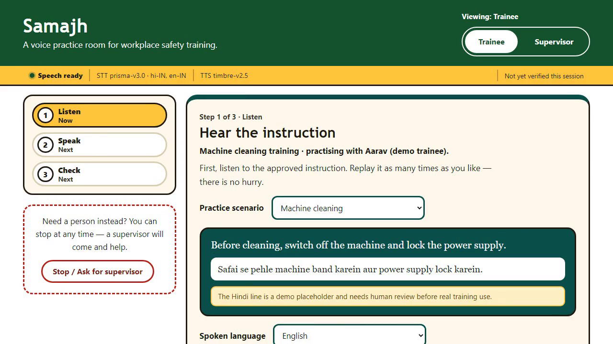
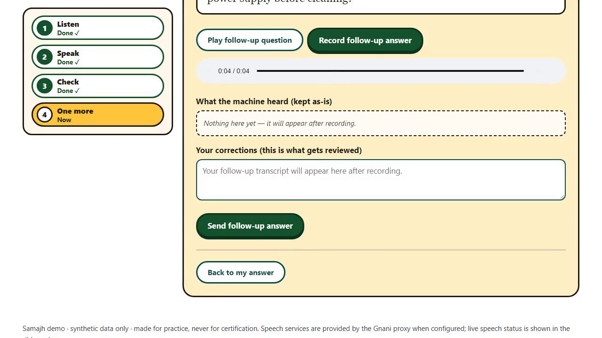
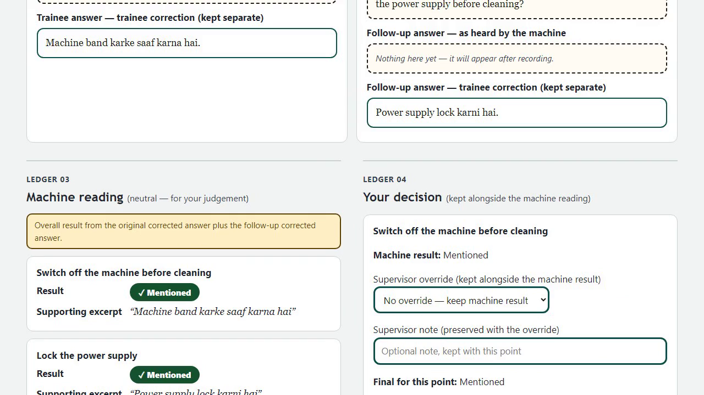

<div align="center">

# Samajh

### Did the instruction land? Let's hear it back.

**A voice-enabled teach-back prototype for workplace safety training.**

[](https://youtu.be/V83c7kDkG3k)
[](https://samajh-text-preview.vercel.app/)
[](https://www.gnani.ai/)
[](https://nodejs.org/)

Built for the **Great Indian AI Internship Challenge**.

[Try the live preview](https://samajh-text-preview.vercel.app/) · [Watch the walkthrough](https://youtu.be/V83c7kDkG3k) · [Run locally](#get-started) · [Developer guide](docs/developer-guide.md)

</div>

---

> **Prototype, not a safety certification system.** Samajh uses fictional scenarios and demonstration data. Its machine checks can be wrong, its Hindi translations require human review, and a qualified supervisor remains responsible for decisions. Do not use it as a substitute for workplace safety training or procedures.

## The idea

Someone can hear an instruction, say “yes,” and still miss a critical detail. Samajh turns that moment into a conversation: the trainee explains an instruction in their own words, the app highlights which predefined points appear in the answer, and a supervisor reviews the evidence.

**Listen → say it back → clarify → review together.**



## See it in action

**[Try the live text-only preview →](https://samajh-text-preview.vercel.app/)**
Use fictional answers. Speech is disabled, and sessions are temporary and may not persist. The preview is not a service for real training records.

[](https://youtu.be/V83c7kDkG3k)

The video includes a synthetic spoken exchange through Gnani's speech services, followed by a tour of the trainee and supervisor views.

## How it works

1. **Choose a scenario.** A trainee selects machine cleaning, ladder safety, or spill response and reads or plays the instruction.
2. **Say it back.** The browser records an answer. Gnani **Prisma** transcribes the speech; the trainee can correct the result before submitting it.
3. **Find the missing piece.** A local rule-based evaluator checks the answer against two predefined points and may ask one focused follow-up.
4. **Keep a human in the loop.** The supervisor sees the conversation, machine findings, and supporting excerpts, and can add an override, note, and sign-off.

<table>
  <tr>
    <td width="50%"><strong>A follow-up, not a guess</strong><br></td>
    <td width="50%"><strong>Evidence for the supervisor</strong><br></td>
  </tr>
</table>

### A small example

> **Instruction:** “Before cleaning, switch off the machine and lock the power supply.”
>
> **Trainee:** “Machine band karke saaf karna hai.”
>
> **Samajh:** The machine step was mentioned; the power-supply step was not. It asks what should happen with the power supply.

The follow-up gives the trainee a chance to add the missing point. The supervisor can still review or override the machine result.

## What powers Samajh

| Piece | Role |
| --- | --- |
| **Gnani Prisma v3.0** | Speech-to-text for recorded answers. |
| **Gnani Timbre v2.5** | Text-to-speech for instructions and follow-up questions when the account has access. |
| **Local evaluator** | Deterministic keyword and paraphrase rules for the three predefined scenarios. It is not Evon or a general-purpose reasoning model. |
| **Node.js + Express** | Serves the app, proxies Gnani requests, evaluates answers, and stores demo sessions. |
| **Vanilla HTML, CSS, and JavaScript** | Trainee and supervisor interfaces, microphone recording, and transcript correction. |

API keys stay on the server. When speech is unavailable, the app shows an error or text fallback instead of pretending a call succeeded.

## Get started

**You need Node.js 18 or newer** and npm. A Gnani API key is needed for speech; without one you can still explore the text flow.

```bash
git clone https://github.com/AnuranjanJain/Gnani.git
cd Gnani
npm install
```

Copy `.env.example` to `.env`, then add your Gnani API key locally. Do not commit the key.

```bash
# macOS / Linux
cp .env.example .env

# Windows PowerShell
Copy-Item .env.example .env
```

```bash
npm test
npm start
```

Open **http://localhost:3000**. Browser microphone access requires a secure context such as localhost or HTTPS.

### Configuration

| Variable | Default | Purpose |
| --- | --- | --- |
| `GNANI_API_KEY` | Empty | Enables authenticated Gnani speech requests. Keep it secret. |
| `GNANI_STT_MODEL` | `prisma-v3.0` | Speech-to-text model. |
| `GNANI_STT_LANGUAGE` | `hi-IN,en-IN` | Languages sent to speech-to-text. |
| `GNANI_TTS_MODEL` | `timbre-v2.5` | Text-to-speech model. |
| `PORT` | `3000` | HTTP server port. |
| `SAMAJH_DATA_DIR` | `./data` | Directory for file-based demo sessions. |

## Project map

```text
public/           Trainee and supervisor interface
lib/scenarios.js  Three fictional scenarios and required points
lib/evaluate.js   Rule-based teach-back evaluation
lib/session-store.js  File-based session persistence
server.js         Express server and Gnani API proxies
test/             Evaluator, API, session, and frontend tests
docs/             Screenshots and detailed developer guide
```

## Current boundaries

- **Human review is essential.** The evaluator can misinterpret language, miss paraphrases, or misunderstand speech recognition errors. A “mentioned” result is not proof of comprehension.
- **Translations are demonstration placeholders.** The Hindi lines need review by a qualified speaker before any real training use.
- **Browser audio only.** There is no telephone integration; recording is limited to 30 seconds.
- **Local demo storage.** Sessions are stored as JSON files. There are no accounts or multi-device synchronization, and ephemeral hosting can erase data without persistent storage. Use synthetic data only.
- **Public-hosting precautions.** The app currently has no authentication or rate limits. Do not expose a configured speech API key through a public deployment without appropriate access controls and usage limits.

For API routes, session behavior, deployment configuration, and verification details, see the [developer guide](docs/developer-guide.md).

---

<div align="center">

**A missed step can become a better conversation.**

[Watch Samajh in action](https://youtu.be/V83c7kDkG3k)

</div>
